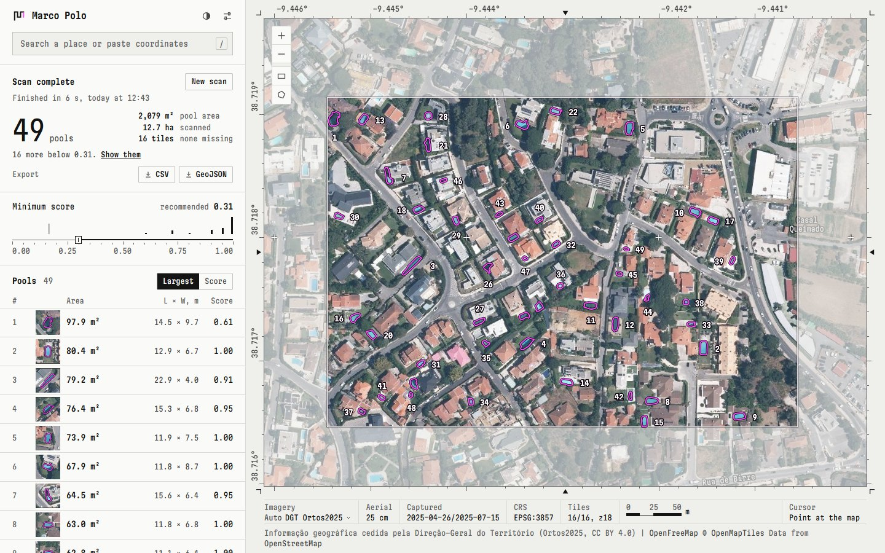
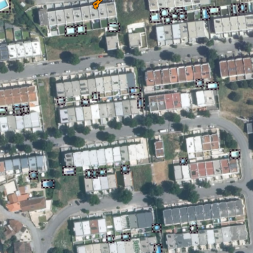
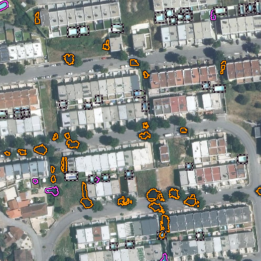
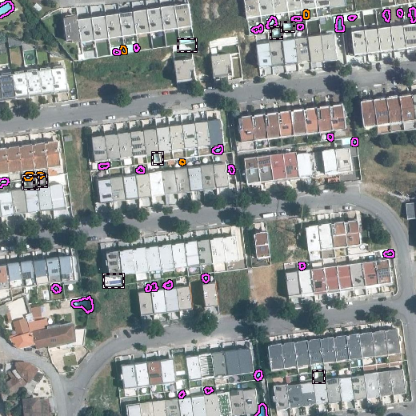

<div align="center">


# Marco Polo

Draw an area on the map. It finds swimming pools in the aerial imagery, measures them and ranks them.

[Live demo](https://sepd0x.github.io/marco-polo/) · [How it is measured](packages/eval/README.md) · [Detection](docs/DETECTION.md) · [Architecture](docs/ARCHITECTURE.md)

<picture>
  <source media="(prefers-color-scheme: dark)" srcset="docs/media/app-dark.jpg">
  
</picture>

</div>

## Before and after

Braga, Portugal, a DEV zone scored out of fold: one crop of the DGT aerial image (25 cm).

<!-- figure: written by scripts/check-readme.mjs -->

| v1 on Esri, as it shipped | v1 on DGT | v2 on DGT |
|:-:|:-:|:-:|
|  |  |  |
| 0 found, 1 wrong, 38 missed | 6 found, 26 wrong, 33 missed | 31 found, 5 wrong, 8 missed |

<!-- /figure -->

Magenta: a labelled pool found. Orange: no pool there. White dashes: missed. v1's Esri outlines are moved onto this image by a measured offset with a weak correlation peak (0.009): the first panel is indicative only. F1 over the whole zone: v1 on Esri 35.7%, v1 on DGT 23.7%, v2 on DGT 89.9%. Drawn by [`figure.ts`](packages/eval/src/figure.ts).

## Results

<!-- results: written by scripts/check-readme.mjs -->

| zones | what they are | pools | v1 F1 | v2 F1 |
|---|---|--:|--:|--:|
| DEV, 6 zones | tuning zones, scored out of fold | 489 | 28.9% [24.6, 33.8] | 79.9% [76.3, 83.1] |
| DEV-2, 5 zones | held out from tuning | 760 | 48.6% [45.0, 52.7] | 74.6% [71.0, 77.9] |
| GOLD, 5 zones | proposed by earlier methods, reviewed one by one | 478 | 65.8% [59.8, 71.0] | 85.4% [82.4, 87.8] |
| TEST, 5 zones | drawn by lot, labelled blind | 1287 | 37.0% [32.3, 42.2] | 89.6% [87.7, 91.1] |
| TEST, 1 zone with no pools | false detections per km² | 0 | 8.0 | 25.0 |

F1 with its 95% interval (block bootstrap). Both versions on the same frozen labels (`92e46aeec9c3`) and the product imagery of each zone; both run at e676b20, 2026-10-10.

<!-- /results -->

On TEST, v2 meets the F1 and error targets fixed before the run and misses three: median area error 18.4% (target 15%), signed area error -15.2% (target within 5%), and 25 false detections per km² in the zone with no pools (v1: 8). See [TEST run 1](packages/eval/results/TEST_RUN_1.md).

## What it does

It runs in the browser, with no server. Imagery follows the place: DGT in Portugal, PNOA in Spain, IGN in France, Esri elsewhere. Every pool gets an outline, an area and a score, plus length and width when the shape allows it.

## Run it

```bash
npm install
npm run dev       # localhost:5173
npm run verify    # bench and gate miss targets today
npm run scan -- --bbox "41.565,-8.385,41.574,-8.373"   # CLI, same detector as the app
```

## Licence

Code: MIT. Labels from OpenStreetMap: [ODbL](packages/eval/labels/ATTRIBUTION.md). Model credits: [ATTRIBUTION](packages/core/models/ATTRIBUTION.md). Imagery terms: DGT and PNOA CC BY 4.0, IGN Licence Ouverte 2.0, Esri its terms of use. Map labels © OpenFreeMap © OpenMapTiles © OpenStreetMap contributors.
