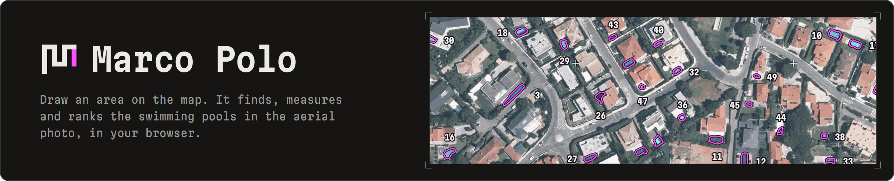
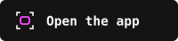
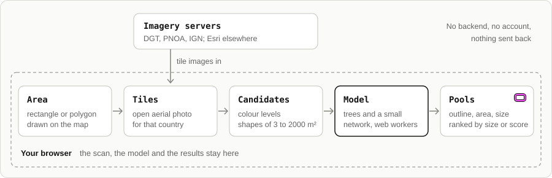
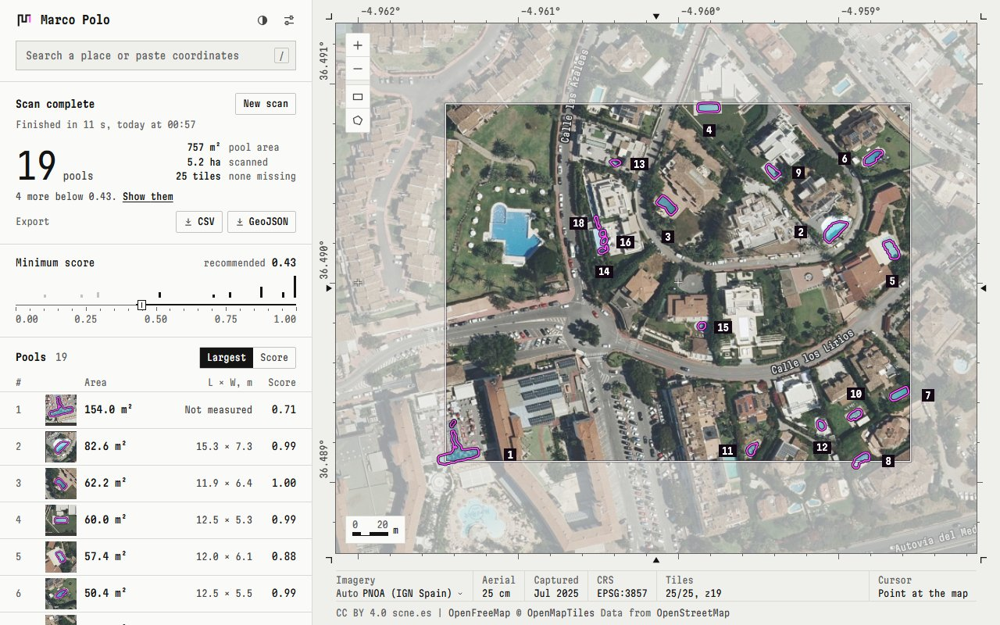
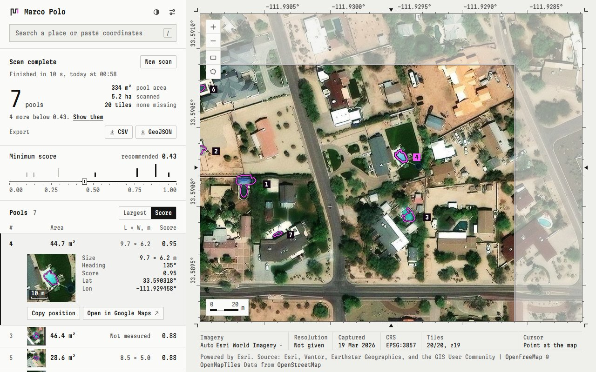
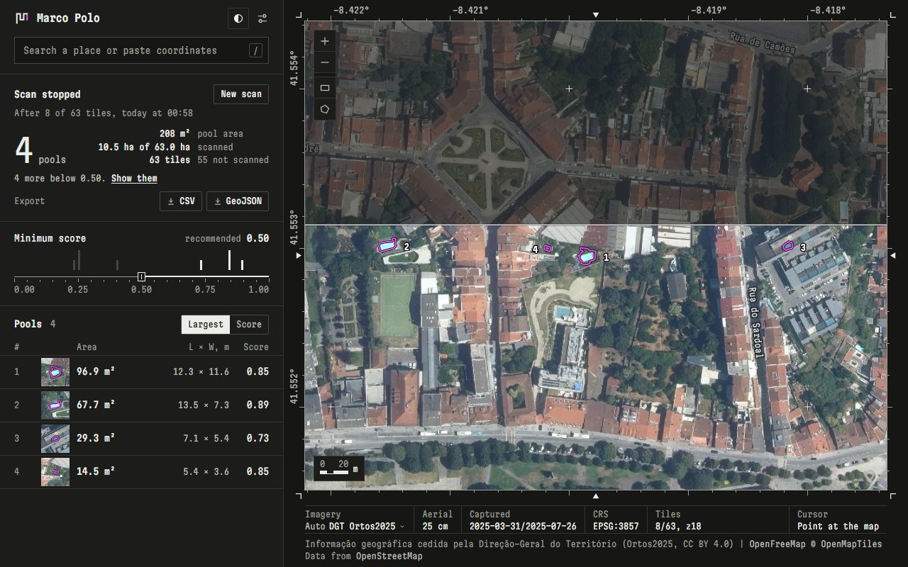
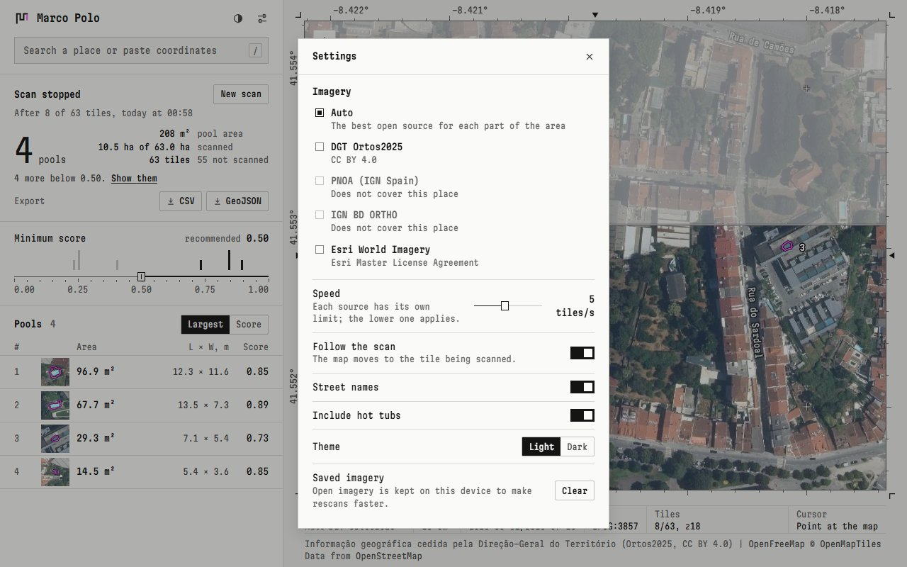
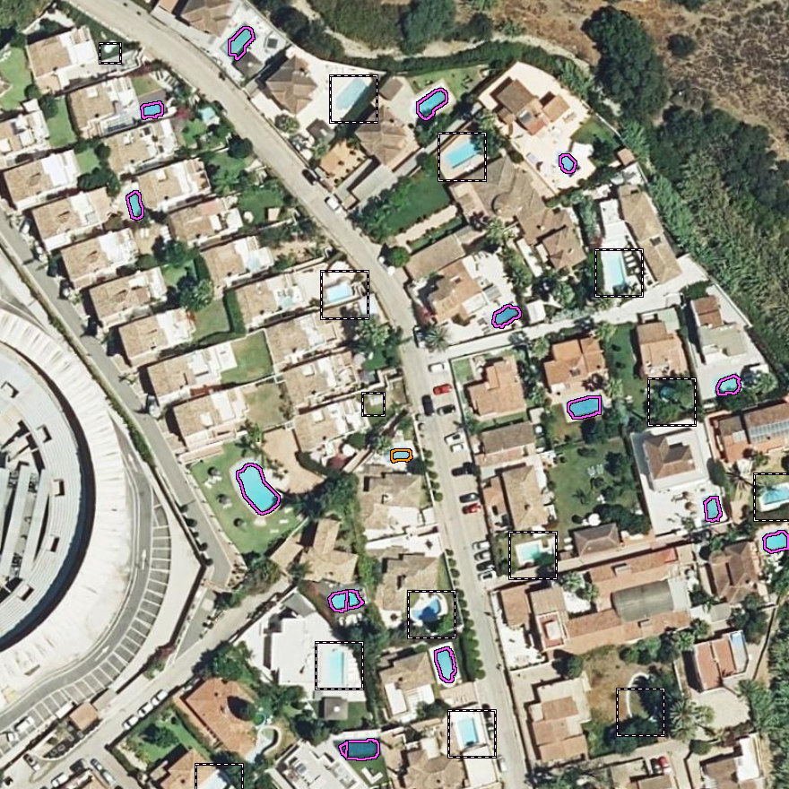
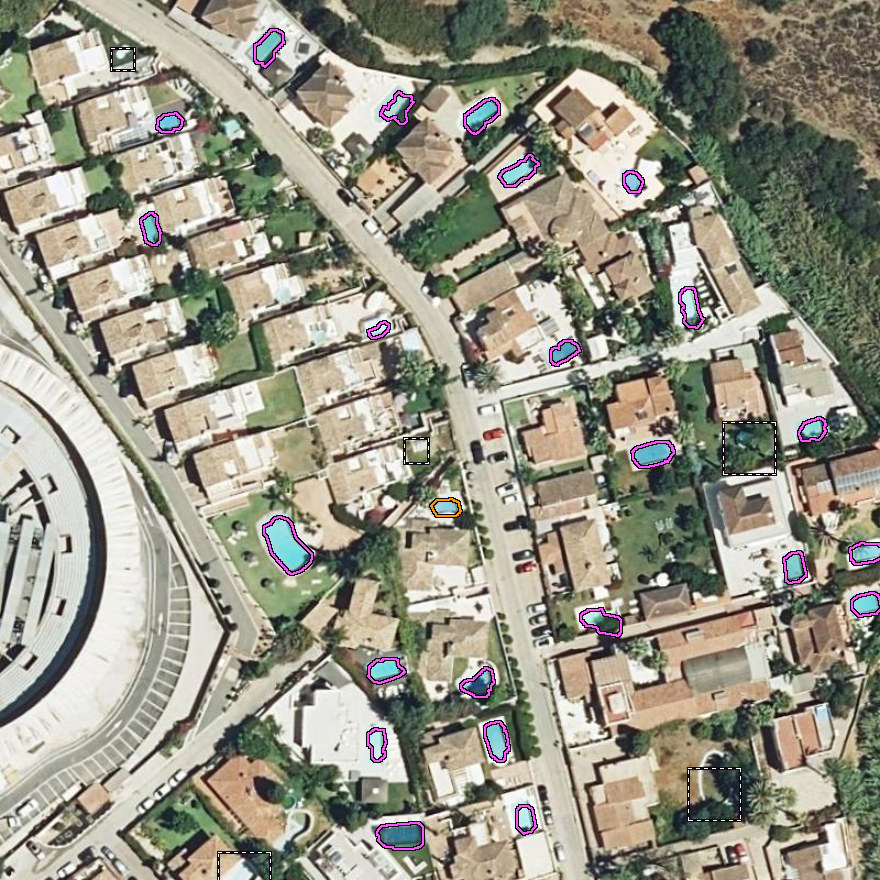

<p align="center">
  
</p>

<p align="center">
  <a href="https://github.com/Sepd0x/marco-polo/releases"></a>
  <a href="https://github.com/Sepd0x/marco-polo/actions/workflows/ci.yml"></a>
  <a href="LICENSE"></a>
  
</p>

<p align="center">
  <a href="https://sepd0x.github.io/marco-polo/">
    <picture>
      <source media="(prefers-color-scheme: dark)" srcset="docs/assets/open-app-dark.svg">
      
    </picture>
  </a>
</p>

<p align="center">
  <sub>Static page, nothing to install. Best on open aerial photos in Portugal, Spain and France.</sub>
</p>

<p align="center">
  <a href="#how-it-works">How it works</a>
  &nbsp;·&nbsp;
  <a href="#results">Results</a>
  &nbsp;·&nbsp;
  <a href="#limits">Limits</a>
  &nbsp;·&nbsp;
  <a href="#run-it">Run it</a>
  &nbsp;·&nbsp;
  <a href="CHANGELOG.md">Changelog</a>
</p>

Marco Polo is a map in the browser. Draw an area on it and it reads the aerial photo of that place, finds the swimming pools, draws an outline on each, measures it and lists them by size or by score. The detector runs in your browser; there is no server behind the page.

> [!NOTE]
> It misses covered, empty and shaded pools, and areas come out about 8% small. Outside Portugal, Spain and France it reads Esri imagery, which the model never trained on, and results are much weaker. Details under [Limits](#limits).

<p align="center">
  <picture>
    <source media="(prefers-color-scheme: dark)" srcset="docs/media/app-dark.jpg">
    
  </picture>
</p>

## Who it's for

- You need to count and measure the pools over an area: planning, insurance, or an estimate of water use.
- You want a worked example of a detector that is measured, with blind test zones, intervals and the targets it missed.
- You are learning computer vision in the browser: tiles, canvas pixels, web workers, a small model in plain TypeScript.

## How it works

<picture>
  <source media="(prefers-color-scheme: dark)" srcset="docs/assets/how-it-works-dark.svg">
  
</picture>

The area is cut into tiles of the open aerial photo for that place: DGT in Portugal, PNOA in Spain, IGN in France, at 20 to 25 cm. Elsewhere it uses Esri. Colour finds candidate shapes; each is described with 56 features of colour, shape and context and scored by 300 gradient-boosted trees and a small neural network (84 KB, in web workers). Each pool gets an outline, an area and, when the shape allows, length and width ([detection](docs/DETECTION.md), [architecture](docs/ARCHITECTURE.md)).

## What it does

| Feature | Details |
|---|---|
| Draw an area | A rectangle or a polygon, after a search by place name or pasted coordinates. The area goes into the link, so a link opens the same area. |
| Imagery by place | Each part of the area is read from the best open source that covers it. Settings can fix one source. |
| Score threshold | Each source has its own recommended minimum score; a slider with the score histogram moves it, and the list follows. |
| Measures | Area in m², length and width from the outline when the shape allows, heading and position. A detection of 10 m² or less is tagged a hot tub and can be hidden. |
| Ranking | Largest first, or by score. Opening a pool shows its crop, size, position and a link to the place. |
| Scan control | Pause, resume and stop. Failed tiles can be retried; offline, a scan fails at once, says so, and resumes when the connection is back. |
| Export | CSV and GeoJSON of the pools in the list. |
| Scan archive | Finished scans stay in the browser (IndexedDB) and open again after a reload. |
| CLI | `npm run scan` runs the same detector, windows and thresholds from Node and writes GeoJSON or CSV; a CLI scan and an app scan of the same area list the same pools. |
| Keyboard and phone | Draw, scan and move through the list from the keyboard; on a phone the list sits in a sheet under the map. Light and dark themes. |

<table>
  <tr>
    <td width="50%"></td>
    <td width="50%"></td>
  </tr>
  <tr>
    <td align="center">A scan on PNOA, Marbella</td>
    <td align="center">One pool opened</td>
  </tr>
  <tr>
    <td width="50%"></td>
    <td width="50%"></td>
  </tr>
  <tr>
    <td align="center">A stopped scan, dark theme</td>
    <td align="center">Settings</td>
  </tr>
</table>

## Results

Three releases, one benchmark: v0.1 is the colour rules of the first release, v0.2 the first release of the learned detector, v1.0 its current model ([changelog](CHANGELOG.md)).

<!-- headline: written by scripts/check-readme.mjs -->

On five places drawn by lot and labelled blind, v1.0 scores F1 89.2% [87.3, 90.8] against 37.4% for v0.1. It misses two of the nine targets fixed before the first run; see [Limits](#limits).

<!-- /headline -->

<!-- results: written by scripts/check-readme.mjs -->

| zones | pools | v0.1 F1 | v1.0 F1 |
|---|--:|--:|--:|
| Tuning (DEV) | 489 | 28.9% [24.6, 33.9] | 80.6% [77.1, 83.7] |
| Held out (DEV-2) | 760 | 48.6% [45.0, 52.7] | 74.3% [70.6, 77.7] |
| Reviewed (GOLD) | 478 | 66.1% [60.0, 71.2] | 85.5% [82.6, 88.1] |
| Test (TEST) | 1287 | 37.4% [32.6, 42.6] | 89.2% [87.3, 90.8] |
| Test, no pools: false detections per km² | 0 | 8.0 | 31.0 |

F1 with its 95% interval; same labels and imagery for both, both run on 28 Oct 2026 ([method](packages/eval/README.md), [TEST run](packages/eval/results/TEST_RUN_2.md)).

<!-- /results -->

<!-- notes: written by scripts/check-readme.mjs -->

TEST beats tuning because F1 is counted over pools and La Nucía holds 894 of the 1287. Per place it runs from 60.5% (Dammarie-les-Lys) to 94.1% (La Nucía), mean 79.0%.

Against v0.2, the [previous model](packages/eval/results/TEST_RUN_1.md), v1.0 gives up no F1 (89.6% to 89.2%) for better areas (median error 18.6% to 14.6%) and large pools (25 to 46 of 69 pools of 400 m² or more, where v0.1 still finds 60), with more false detections in the zone with no pools (25 to 31 per km²).

Reported apart: Brixen, winter Esri imagery in the Alps, where v1.0 finds 2 of 20 pools and v0.1 does better.

v0.1 was built for Esri: 55.9% on tuning and 70.3% held out there (older labels). On the open photos tree canopy passes its colour rules.

<!-- /notes -->

### On the same photo

<!-- figure: written by scripts/check-readme.mjs -->

Marbella, PNOA aerial photo, 192 m across, a held-out zone.

| v0.1, colour rules | v1.0, current |
|:-:|:-:|
|  |  |
| 14 found, 1 wrong, 14 missed | 23 found, 1 wrong, 5 missed |

Over the whole zone the gap is narrower: v0.1 68.0%, v1.0 72.9%.

<!-- /figure -->

Magenta: pool found. Orange: no pool there. White dashes: pool missed ([`figure.ts`](packages/eval/src/figure.ts)).

## Limits

<!-- limits: written by scripts/check-readme.mjs -->

- Areas still come out small: signed median error -8.1% on TEST, target within 5%. The median error (14.6%, 28 outlines) meets its 15% target.
- The test zone with no pools is a port: 31 false detections per km², against 8 for v0.1.

<!-- /limits -->

- Covered, empty and shaded pools are missed; blue cars, solar panels and teal roofs pass at times.
- Worker speed: within target on a Ryzen AI 9 365 laptop (p95 60 ms per 512 px request, target 150); slower CPUs are not measured with v1.0 ([bench](tests/bench/RESULTS.md)).
- Firefox and Safari are not measured.

## Privacy and security

No backend, account or API keys: static files on GitHub Pages; results stay in your browser. A Content Security Policy meta tag allows connections only to the imagery hosts, OpenFreeMap and Nominatim. CI runs with a read-only token. Flaws: [SECURITY.md](SECURITY.md).

It finds pools on private property: use it for counts over an area, not to look into a person or address ([responsible use](docs/IMAGERY.md#responsible-use)).

## Run it

```bash
# Node 24
npm install
npm run dev          # http://localhost:5173
npm run scan -- --bbox "36.491,-4.959,36.494,-4.956"   # CLI
```

`npm run verify` runs everything; its release gate fails on the missed targets.

## Licence

Code MIT. OpenStreetMap labels [ODbL](packages/eval/labels/ATTRIBUTION.md); model [credits](packages/core/models/ATTRIBUTION.md). Imagery: DGT and PNOA CC BY 4.0, IGN Licence Ouverte 2.0, Esri terms of use. Map labels © OpenFreeMap © OpenMapTiles © OpenStreetMap contributors.
